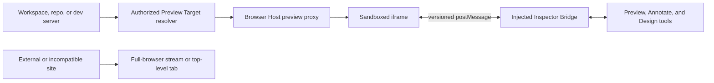

# ADR-0034: First-Class Preview Targets and Web Annotation

## Status

Accepted

Date: 2026-11-07

Related: [ADR-0004](./ADR-0004-browser-runtime-surfaces.md),
[ADR-0011](./ADR-0011-browser-agent-session-binding.md),
[standard 12](./standards/12-live-browser-and-preview.md)

## Context

ADR-0004 already selects a sandboxed iframe for managed web previews and a
streamed full-browser surface for arbitrary browser sessions. The Project
preview proxy provides an authenticated route, forwards HTTP and HMR WebSockets,
and injects the Inspector Bridge. Remote desktop remains a separate surface.
The Preview product direction should preserve those boundaries.

The canonical Preview entry is the Preview tab in the existing chat workspace
header. The canvas and its design tools live in that workspace's right-hand
pane; Preview is not a separate application page. Legacy Preview URLs only
redirect into the project/chat flow. The tab lets users choose an authorized
code project in the workspace. Browser APIs resolve a target from either the
active chat or the selected project, discover servers across that project's
active sandboxes, and prefer the active chat's server when it belongs to the
selected project. Targets are reusable across chats, but providers are still
limited to project sandbox servers; worktree servers and read-only external
URLs are not yet available.

The selected project, opaque target, pathname, and desktop/mobile viewport
preference now persist in the browser profile under a user-and-workspace key, so
opening another chat in that profile does not silently switch Preview back to
that chat's project or device view. Restored project ids are filtered against
the current workspace's authorized project list; the server still re-resolves
every target before opening its proxy.
The active managed-preview pathname is also remembered per opaque target. The
bridge reports full-page and SPA route changes, while durable state keeps only
the validated pathname and drops query strings, fragments, session ids, and
upstream origins. The Browser Host validates the route again before redirecting
the authenticated iframe bootstrap to it.

The Inspector Bridge supports live element selection, temporary text and style
edits, DOM layers, CSS-variable controls, and browser actions. Project-scoped
annotations retain screenshots, locator context, and a content-derived source
revision covering the repository state at capture time. The Browser Host only
attaches a revision when the source is stable across screenshot capture; the
web server signs a short-lived receipt bound to the user, project, target,
page, viewport, source revision, and screenshot bytes before accepting a new
annotation. Existing annotations without a revision remain readable. The
bridge's element references still belong to one running page, and visual edits
do not map directly to source files or durable component identifiers.

Local and Cloud workspaces previously used different Preview paths. Local mode
used the managed iframe and Inspector Bridge; Cloud mode used a session-bound
computer-service iframe without the bridge and hid the design panel. That
surface could display a running page, but it could not provide the same live
editing and annotation capabilities.

### Product interaction requirements

Users open Preview from the Preview tab in the existing chat workspace. This
tab is the entry and the only place that renders the managed Preview canvas; a
project-list action may open a chat with Preview selected, but it must not
render a second Preview page. The tab provides the embedded canvas, responsive
viewport, navigation controls, and Edit, Theme, Layers, and Annotate tools. Edit
selects live elements and previews temporary text or style changes immediately.
Changes remain pending until applied to an editable source checkout as a
reviewable change. Theme edits available design tokens; Layers navigates the
live document hierarchy. Annotate places numbered comments on the preview and
submits them with screenshot and locator context. A project selector inside the
tab lets users switch among authorized code projects in the workspace. Requests
for the current project use the active chat; requests for another project open
a chat bound to that project. The tab reuses the chat workspace layout and
iframe, while the selected target and its server lifecycle are scoped to the
project or workspace.

OpenLink should separate the running web app from its display surface. The
active chat can provide an initial project context and receive design or
annotation requests. The selected Preview target remains identifiable and
reusable across chats with workspace access.

## Proposed Decision

1. Keep the iframe as the default renderer for managed web apps in both Local
   and Cloud workspaces. Runtime mode selects the authorized target provider;
   it does not change Preview into a computer-service or streamed-browser
   surface. Continue serving managed targets through the authenticated
   HTTP/WebSocket proxy and versioned Inspector Bridge. If no project target is
   available, show a recoverable empty/error state and keep the Agent-owned
   Realtime browser separate. Cloud deployments resolve targets through their
   configured remote Agent Host and Browser Gateway; missing configuration is
   shown as a recoverable error. Use the remote desktop surface only for full
   desktop interaction. Use a streamed full-browser surface for sites or
   applications that cannot safely or reliably be embedded and proxied.

2. Introduce a Preview Target contract independent of a chat session. A target
   belongs to an authorized workspace or project and identifies its source
   provider, runtime environment, entry route, and supported capabilities. Its
   source binding is optional for viewing and annotations; code-edit capability
   requires an explicit editable checkout/worktree and revision. A chat/session
   id may be retained as provenance or a ranking hint, not as the target's
   identity or authorization boundary.

   Initial providers should cover the current Project sandbox server, an
   explicitly selected workspace/repository worktree server, and a read-only
   external URL. Provider URLs, proxy credentials, and runtime secrets remain
   server-side. Browser clients receive opaque target ids and safe labels. An
   external URL is never fetched by a general-purpose server-side proxy; if it
   cannot be embedded directly, open it in the isolated full-browser surface or
   a top-level tab without Inspector Bridge privileges.

3. Make Preview navigation state belong to the selected target and its viewport,
   not to an ephemeral Browser Host session. Recreating the iframe transport,
   changing chat tabs, or closing the Browser panel must not change the target
   or stop its development server. Persist the selected project and opaque
   target preference per user and workspace, without persisting upstream URLs
   or credentials. Persist a validated pathname and desktop/mobile viewport
   preference per target; do not persist query strings or fragments. Revalidate
   both project access and target liveness on restore. The active chat can still
   be recorded as the initiating context and receive code-change requests.

4. Build visual tools as modes over the same live Preview document and bridge:

   - **Preview** renders the running app and supports responsive/device
     viewports, navigation, reload, and hot reload.
   - **Annotate** adds numbered comments anchored to a target revision, a
     screenshot, and a best-effort DOM locator/rectangle. Comments are sent to
     the project code chat as one batch and do not mutate source code.
     Store annotation metadata in Postgres and new screenshots in private,
     project-scoped object storage. Continue reading legacy inline screenshots
     during migration. Resolve screenshot content only after project
     authorization; never expose a public object URL.
   - **Design** supports element selection, pending style edits, undo/redo,
     before/after, and natural-language instructions with selected-element and
     viewport screenshots. Apply sends a structured request to the selected
     project's code chat. The code-editing path must produce a reviewable source
     diff associated with that project's editable checkout; direct DOM mutations
     remain temporary preview feedback. Apply is unavailable in a read-only chat.
     Applying to another project opens a project-bound chat in confirmation mode,
     so file writes still require explicit approval.
   - **Theme** and **Layers** are capabilities of the Design panel, not separate
     browser runtimes. Theme controls may use project design tokens when the
     source adapter can identify them. Layers initially expose the live DOM
     hierarchy; component and source-file labels are enhanced metadata when an
     adapter can provide them.

5. Resolve and authorize every target server-side against workspace/project
   membership. Issue short-lived target capabilities for iframe requests and
   validate bridge messages against `event.source`, target/session identity,
   nonce, and allowed origin. Do not return upstream URLs, headers, or runtime
   credentials to the browser. A target without source-edit permission must
   never expose Design Apply, even if it supports read-only inspection or
   annotations.

6. Retain the Browser Protocol as the shared automation contract. Keep the
   agent's durable browser session independent from the UI-owned iframe
   session, as required by standard 12. Add Preview Target ownership alongside
   that protocol instead of making the agent browser session own Preview.

The proposed request and tool flow is:

## Consequences

### Positive

- Managed web development uses native DOM rendering, preserving browser
  responsiveness, text selection, form behavior, and HMR without framebuffer
  transport overhead.
- Preview can be opened and reused across chats and repositories within the
  user's authorized workspace, with an optional connection back to a code-edit
  task.
- Annotation and Design can share one selection/bridge layer while keeping
  comments, temporary style previews, and source edits as distinct operations.
- A target with no editable checkout remains useful for viewing and feedback
  without implying that arbitrary sites can be changed.

### Negative

- Target ownership and lifecycle move from an implicit chat lookup to explicit
  workspace/project records and provider adapters.
- Durable annotations and source edits need stronger identity than the current
  page-local element reference; selectors can become stale after app updates.
- Framework-aware source mapping, design-token mapping, and code patching will
  be incomplete for some repositories. The UI must disclose when it can only
  send an instruction or screenshot.
- Iframe embedding still depends on managed proxy behavior, CSP, asset paths,
  cookies, and WebSocket handling. It cannot replace a full browser for every
  external site.

### Neutral

- Chat session remains useful as a default target hint and as the receiver of
  annotation or design instructions, but it no longer defines Preview's
  lifetime.
- Remote desktop remains available for native desktop applications and full-OS
  interaction; it is not involved in web Preview rendering.

## Alternatives Considered

### Render every Preview through remote desktop streaming

Rejected for web development. It streams pixels and input, adds CPU and
bandwidth cost, and does not provide the native DOM and bridge needed for
element-level inspection and annotations. It remains appropriate for full
desktop interaction.

### Bind the Preview target only to the active chat

Rejected as the target identity and authorization model. The Preview tab remains
inside the chat workspace, but a target belongs to its authorized project or
workspace and can be selected from another chat. The active chat is context for
requests, not the target's identity.

### Put every arbitrary URL behind the managed preview proxy

Rejected. This would turn a server-side proxy into an unrestricted network
fetcher, would expose credentials and internal services to SSRF paths, and
cannot reliably rewrite CSP, workers, redirects, or WebSockets. Only explicitly
managed targets receive proxy and bridge privileges.

### Make visual edits directly in the live DOM

Rejected as a save model. It can show immediate feedback but is lost on reload
and cannot be reviewed or applied to the repository. DOM changes may be used as
temporary pending preview state before a source-aware Apply operation.

## Rollout Plan

1. **Project-scoped Preview:** stabilize the project target contract, iframe
   lifecycle, navigation controls, authenticated proxy behavior, and in-chat
   project selector independent of the initiating chat.
2. **Target providers:** add explicitly selected worktree targets and read-only
   external URLs. Keep URL resolution, secrets, and authorization server-side;
   use the isolated full-browser surface when direct embedding is unavailable.
3. **Web annotations:** retain metadata and private screenshots across reloads
   and send selected comments as a batch with screenshot and locator context.
   Target revisions now bind the captured source state to an authenticated
   screenshot receipt and persist with each new annotation. The remaining work
   is durable locator matching and recovery across app updates.
4. **Design panel:** keep the panel inside the existing chat workspace Preview
   tab. The first implementation provides selected-element and viewport
   context, temporary text, typography, color, and layout edits, Cmd/Ctrl-drag
   positioning, undo/redo, before/after, CSS-variable controls, and live DOM
   layers. Apply routes the structured request and screenshots to the selected
   project's code chat. Add source-aware token mapping, component metadata, and
   explicit diff linkage through source adapters.

Do not update binding standard 12 until this ADR is accepted and the first two
steps have an implementation contract. At that point, revise its target scope
from chat-led Project discovery to workspace/project authorization and record
the remaining code-edit requirements as follow-up decisions if needed.

## Validation Criteria

1. In Local and Cloud workspaces, open a managed target and confirm Preview
   uses the iframe, Inspector Bridge, and design panel. When no target is
   available, confirm Preview stays in its recoverable empty/error state and
   does not replace the Agent-owned Realtime browser.
2. Open the same managed target from two chats with access to its workspace;
   target identity and dev-server lifetime remain stable.
3. Open two repositories/worktrees from one authorized workspace and switch
   between them without leaking either target's URL, headers, cookies, or
   runtime credentials to another target.
4. Confirm iframe navigation, reload, assets, cookies, and HMR WebSockets work
   through the authenticated path at desktop and mobile viewport sizes.
5. Confirm an external site that rejects framing is handled by the documented
   full-browser/top-level fallback and does not receive an injected bridge.
6. Add multiple annotations, submit them as one batch, and verify they retain
   screenshot, target revision, and best-effort locator context after reload.
7. Apply a Design edit to an editable worktree and verify a reviewable source
   diff; confirm read-only targets cannot invoke Apply.
8. Keep Realtime and remote desktop usable independently when Preview is
   opened or closed.
9. Confirm Design text and style edits, color controls, and Cmd/Ctrl-drag
   positioning update the live page and restore correctly through undo, reset,
   and before/after.
